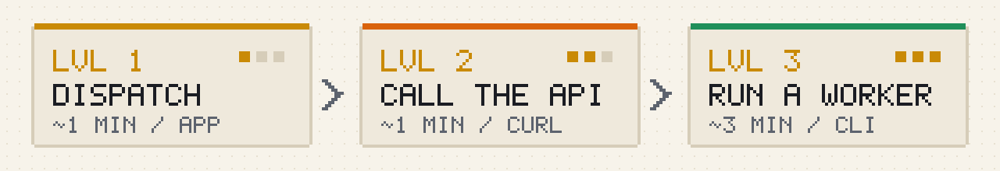
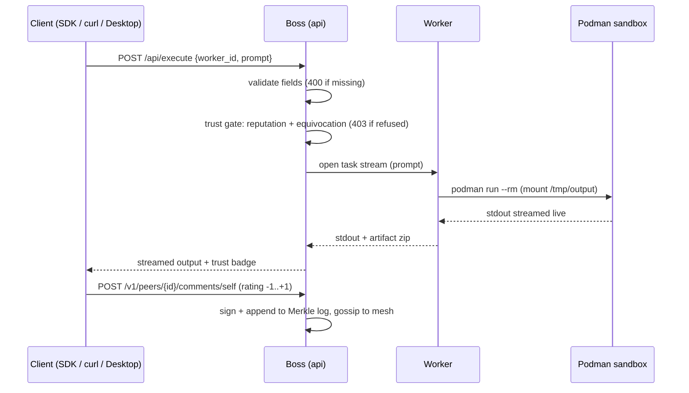
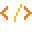

<div align="center">

<picture>
  <source media="(prefers-color-scheme: dark)" srcset=".github/assets/hero-dark.svg">
  
</picture>

<h3>Run your AI agents on machines you already own, as one private network.</h3>

Package an agent as a container, run it on any Mac or Linux box with spare capacity, and send it work from a desktop app, a `curl` one-liner, or any OpenAI SDK.<br>
Traffic is end-to-end encrypted, there is no cloud account, and on a private swarm your prompts and files only travel between machines in your swarm.

[](https://github.com/Agent-FM/agentfm-core/releases)
[](https://github.com/Agent-FM/agentfm-core/actions/workflows/go-test.yml)
[](https://pypi.org/project/agentfm-sdk/)
[](agentfm-go/go.mod)
[](LICENSE)
[](https://github.com/Agent-FM/agentfm-core/stargazers)

**[Who it's for](#-who-its-for)** · **[5-minute quest](#-the-5-minute-quest)** · **[How it works](#-how-it-works)** · **[Compare](#-how-it-compares)** · **[Python SDK](#-python-sdk)** · **[Docs](#-docs)** · **[Community](#-community)** · **[agentfm.net](https://agentfm.net)**

</div>

<br>

##  Why AgentFM

You probably have more compute than you think. The laptop you're reading this on. The desktop with a GPU that sits idle most of the day. A homelab box, a teammate's workstation, the old server in the corner. Meanwhile your agents run on someone else's cloud, billed per token, with your prompts and files leaving the building.

AgentFM turns those machines into **one mesh**. Install one binary (or the desktop app) on each machine and they find each other: instantly over mDNS on the same Wi-Fi, through a relay lighthouse everywhere else, even behind NAT. Each agent runs in a throwaway Podman sandbox on one machine that has room, and you talk to the whole mesh as if it were one OpenAI endpoint.

- **Your hardware, pooled.** Workers report CPU, GPU, RAM and queue depth every ~2 s, and each task goes to the least-loaded machine that can run it.
- **Your data stays on your machines, on a private swarm.** Tasks go peer to peer over encrypted libp2p streams. Add a swarm key and only your own machines can even see the network. On the public mesh, the worker that runs a task sees its prompt.
- **Your code already works.** The gateway speaks the OpenAI wire format, so LangChain, LlamaIndex, LiteLLM, Open WebUI and the `openai` SDKs just need a new `base_url`.
- **Trust without a middleman.** Every rating is Ed25519-signed and lands in a per-peer, append-only Merkle log. Reputation is computed from that log, and peers caught rewriting history are blocked mesh-wide. No allow-lists, no central server, no blockchain. → [How trust works](docs/trust.md)

##  Who it's for

- **Small teams with idle hardware** who want AI agents running on their own machines: no per-token bill, and no prompts sent to an AI provider.
- **Developers already using the OpenAI SDK** who want to point existing code at their own hardware by changing the base URL.
- **Agent builders** who want to publish an agent on the public mesh and let its reputation grow from signed, verifiable ratings.

| Use case | How it works with AgentFM |
|---|---|
| **A team assistant on one shared machine** | A Mac running Ollama hosts an HR or docs agent. Colleagues send requests from the desktop app and get files back. See [`sick-leave-generator`](agent-example/sick-leave-generator). |
| **Batch work across every idle machine** | `client.tasks.scatter` spreads hundreds of prompts over all available workers with failover and retry. See [`02_batch_scatter_gather.py`](agentfm-python/examples/02_batch_scatter_gather.py). |
| **Sharing the one GPU in the office** | One machine runs an image-generation agent; everyone else dispatches to it. See [`image-generator`](agent-example/image-generator). |
| **Existing apps, new hardware** | Anything that speaks the OpenAI API can call the gateway at `/v1/chat/completions`. See [OpenAI-compatible API](docs/openai.md). |

##  The 5-minute quest

<picture>
  <source media="(prefers-color-scheme: dark)" srcset=".github/assets/quest-dark.svg">
  
</picture>

### LVL 1 · Dispatch a task from the desktop app

1. Download the app from [**Releases**](https://github.com/Agent-FM/agentfm-core/releases): `AgentFM-*.dmg` (macOS, arm64 and x64) or `AgentFM-*.AppImage` (Linux). Windows is in progress.
2. Launch it. It bundles a full AgentFM node and joins the public mesh on its own.
3. Open **Mesh Radar**, pick an agent, press **Dispatch**, and watch the output stream back. Rate the result when it's done.

<details>
<summary>macOS says the app can't be opened?</summary>

The v1 installers aren't signed yet. Allow the first launch in **System Settings → Privacy & Security → Open Anyway**, or clear the quarantine flag before mounting:

```bash
xattr -d com.apple.quarantine ~/Downloads/AgentFM-*.dmg
```
</details>

### LVL 2 · Call the mesh from your own code

While the app is running, its node serves the AgentFM API on `127.0.0.1:8080`. Anything that speaks OpenAI can use the mesh now.

```bash
# every agent your node can see, with its hardware and load
curl -s http://127.0.0.1:8080/v1/models
```

```python
from openai import OpenAI

client = OpenAI(base_url="http://127.0.0.1:8080/v1", api_key="unused-on-localhost")
reply = client.chat.completions.create(
    model="llama3.2",   # a model engine, an agent name, or a peer ID
    messages=[{"role": "user", "content": "Draft a sick-leave email for tomorrow."}],
)
print(reply.choices[0].message.content)
```

`model` matches a peer ID first, then an agent name, then a model engine; the least-loaded match wins. Use one of the names `/v1/models` lists. → [OpenAI-compatible API](docs/openai.md)

> No desktop app? Install the binary with `curl -fsSL https://api.agentfm.net/install.sh | bash` and run `agentfm -mode api` for the same gateway. → [Install](docs/install.md)

### LVL 3 · Put your own machine on the mesh

This level needs [Podman](https://podman.io) (the sandbox) and [Ollama](https://ollama.com) (a local model). If you have both, it takes about three minutes.

<details>
<summary>Install Podman and Ollama (macOS shown; use your package manager on Linux)</summary>

```bash
brew install podman && podman machine init && podman machine start
curl -fsSL https://ollama.com/install.sh | sh && ollama pull llama3.2
```
</details>

```bash
curl -fsSL https://api.agentfm.net/install.sh | bash   # skip if you installed it in LVL 2
git clone https://github.com/Agent-FM/agentfm-core && cd agentfm-core

agentfm -mode worker \
  -agentdir ./agent-example/sick-leave-generator/agent \
  -image agentfm-sick-leave:v1 -model llama3.2 \
  -agent "HR Assistant" -maxtasks 10
```

Your machine now shows up in Mesh Radar and in `/v1/models`. Every task runs in a fresh `podman run --rm` container, and any files the agent writes to `/tmp/output` come back zipped to `./agentfm_artifacts/<task_id>.zip`. **Quest complete.**

<details>
<summary>Next: publish your own agent to the public mesh</summary>

There's no allow-list. Push your image anywhere, start a worker, and your agent is live. Reputation builds up from honest behaviour over time.

```bash
podman build -t ghcr.io/you/myagent:v1 ./my-agent && podman push ghcr.io/you/myagent:v1
agentfm -mode worker -agentdir ./my-agent -image ghcr.io/you/myagent:v1 \
  -agent "My Agent" -capability "research-assistant" -model llama3.2
```

The public lighthouse is built in: `/ip4/78.47.21.107/tcp/4001/p2p/12D3KooWQHw8mVQkx17kLTNiRTbYckU2cAGcAwFFLzVJhhmBs5zL`. Raise the dispatch gate with `--reputation-floor=-0.3`, or leave the public mesh entirely with a [private swarm](docs/private-swarms.md). Writing an agent: [docs/worker.md](docs/worker.md).
</details>

##  How it works

<picture>
  <source media="(prefers-color-scheme: dark)" srcset=".github/assets/how-it-works-dark.svg">
  
</picture>

One `agentfm` binary, and `-mode` picks the role:

| Role | What it does |
|---|---|
| **Worker** | Runs your agent in a fresh Podman sandbox and broadcasts its live hardware to the mesh. |
| **Boss** | Finds workers and dispatches tasks: the desktop app, the `api` gateway, or the `boss` terminal UI. |
| **Relay** | A lighthouse that helps peers find each other and punch through NAT, and keeps a copy of the trust ledger so a fresh node can catch up. Tasks go directly between peers; only when NAT can't be punched do they pass through the relay, still end-to-end encrypted. |

<details>
<summary>Follow one dispatch, step by step</summary>

Every dispatch passes the **trust gate** before a stream opens. Peers caught equivocating are blocked, peers below `--reputation-floor` get `403`, and missing fields fail fast with `400`.



Wire protocols and internals: [docs/architecture.md](docs/architecture.md).
</details>

##  How it compares

| | Cloud AI API | A model server on one machine (e.g. Ollama) | **AgentFM** |
|---|---|---|---|
| Where it runs | The provider's servers | One machine | Any machines you add to the mesh |
| Where your prompts go | To the provider | Stay on that machine | Private swarm: only machines in your swarm. Public mesh: the worker that runs the task |
| Unit of work | A model call | A model call | A whole agent in a container: its own code and tools, with files returned |
| OpenAI SDK compatible | Yes | Yes | Yes |
| Shares hardware across people | — | No | Yes, routed by live CPU/GPU/RAM load |
| Cost | Per token | Your hardware | Your hardware |

AgentFM does not replace a model server: a worker usually runs one (Ollama, vLLM) next to its agent.

**What AgentFM is not:**
- **Not a way to split one model across machines.** Each task runs on a single worker; the mesh spreads *many* tasks, not one big one.
- **Not a paid compute marketplace.** Nobody pays anybody; reputation is the only currency.
- **Not private on the public mesh.** A task's prompt is visible to the worker that runs it. For confidential work, use a [private swarm](docs/private-swarms.md).

##  Desktop app

A mesh console for macOS and Linux: see every agent, dispatch, chat, rate, and collect artifacts. No terminal needed, and it ships the full backend, so installing it gives you a complete node.

<table>
  <tr>
    <td width="50%"><br><sub><b>Mesh Radar</b>: every agent, live load, honesty stars, one-click dispatch</sub></td>
    <td width="50%"><br><sub><b>Dispatch</b>: live-streamed output with a trust badge</sub></td>
  </tr>
</table>

<details>
<summary>More screens: chat, agent profile, artifacts, status</summary>

<table>
  <tr>
    <td width="50%"><br><sub><b>Chat</b>: pin an agent, stream replies, rate each one</sub></td>
    <td width="50%"><br><sub><b>Agent profile</b>: reputation, signed ratings, Merkle-backed history</sub></td>
  </tr>
  <tr>
    <td width="50%"><br><sub><b>Artifacts</b>: every file an agent produced, by project</sub></td>
    <td width="50%"><br><sub><b>Status</b>: node health, relay connectivity, reachability</sub></td>
  </tr>
</table>
</details>

Full tour: [docs/DESKTOP.md](docs/DESKTOP.md) · build it yourself: [agentfm-desktop/](agentfm-desktop/README.md)

##  Python SDK

```bash
pip install agentfm-sdk
```

```python
from agentfm import AgentFMClient

with AgentFMClient(gateway_url="http://127.0.0.1:8080") as client:
    workers = client.workers.list(model="llama3.2", available_only=True)
    result = client.tasks.run(worker_id=workers[0].peer_id, prompt="Draft a leave policy.")
    print(result.text, result.artifacts)   # artifacts: list[Path], auto-extracted
```

Typed sync and async clients, the full OpenAI-compatible namespace, `scatter` / `scatter_by_model` batch dispatch, and signed webhook callbacks. → [SDK guide](agentfm-python/README.md) · [HTTP API reference](docs/http-api.md)

##  One binary, six modes

Each mode has its own flags (`agentfm --help`). Add `-swarmkey` and `-bootstrap` to put any of them on a private swarm.

| Mode | Role | Example |
|---|---|---|
| `worker` | Run your agent in a Podman sandbox | `agentfm -mode worker -agentdir ./a -image a:v1 -agent "My Agent" -model llama3.2 -maxtasks 4` |
| `api` | Headless HTTP + OpenAI gateway (what the desktop app runs) | `agentfm -mode api -apiport 8080 -reputation-floor -0.3` |
| `boss` | Interactive terminal dispatcher | `agentfm -mode boss` |
| `relay` | Lighthouse: Circuit Relay v2, DHT, archive ledger | `agentfm -mode relay -port 4001 -swarmkey ./swarm.key` |
| `witness` | Ledger-only replica that catches equivocation | `agentfm -mode witness` |
| `genkey` | Generate a private-swarm key | `agentfm -mode genkey` |

Every flag: [docs/cli.md](docs/cli.md).

##  Docs

| Get started | Run it | Under the hood |
|---|---|---|
| [Install the binaries](docs/install.md)<br>[Desktop app guide](docs/DESKTOP.md)<br>[Python SDK](agentfm-python/README.md)<br>[OpenAI-compatible API](docs/openai.md) | [Run a worker](docs/worker.md)<br>[Private swarms](docs/private-swarms.md)<br>[Authentication](docs/auth.md)<br>[Observability](docs/observability.md)<br>[CLI reference](docs/cli.md) | [Architecture & wire protocols](docs/architecture.md)<br>[Trust & verification](docs/trust.md)<br>[Security model](docs/security.md)<br>[HTTP API reference](docs/http-api.md)<br>[Changelog](CHANGELOG.md) |

##  Contribute

AgentFM is a monorepo: the Go node in [`agentfm-go/`](agentfm-go), the Electron app in [`agentfm-desktop/`](agentfm-desktop), the SDK in [`agentfm-python/`](agentfm-python), example agents in [`agent-example/`](agent-example) and the website in [`agentfm-web/`](agentfm-web).

- Start with an issue labelled [**good first issue**](https://github.com/Agent-FM/agentfm-core/labels/good%20first%20issue), or build a new example agent.
- Branch as `feature/…`, `bugfix/…` or `docs/…`, and read [CONTRIBUTING.md](CONTRIBUTING.md) and [docs/development.md](docs/development.md) to build from source.
- Everyone here follows the [Code of Conduct](CODE_OF_CONDUCT.md).

<br>

##  Community

- **Questions, ideas, show-and-tell:** [GitHub Discussions](https://github.com/Agent-FM/agentfm-core/discussions)
- **Bugs and feature requests:** [Issues](https://github.com/Agent-FM/agentfm-core/issues)
- **Security reports:** please report privately as described in [SECURITY.md](SECURITY.md), not in a public issue.
- **Contributing:** start with [CONTRIBUTING.md](CONTRIBUTING.md).

---

<div align="center">
<a href="https://github.com/Agent-FM/agentfm-core/stargazers">
<picture>
  <source media="(prefers-color-scheme: dark)" srcset=".github/assets/footer-dark.svg">
  
</picture>
</a>

<sub>Apache 2.0 · Built with Go, libp2p and Podman, and the belief that compute should belong to the people who own it.</sub>
</div>
